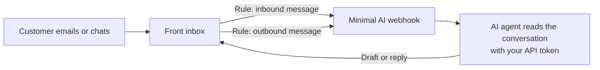

Connecting Front lets your AI agents read incoming conversations in your Front inboxes and place draft replies (or send replies, once automation is on) directly in Front.

We set up the Front connection together with you. You prepare a few things in Front, send us two credentials, and we finish the connection on our side. It takes about 10 minutes.

<Note>
  Running into issues connecting Front? Email [maarten@gominimal.ai](mailto:maarten@gominimal.ai) for help.
</Note>

## How it works

- **Inbound rule**: every new customer message is sent to Minimal AI, so the agent can prepare an answer.
- **Outbound rule**: every reply from your team is sent to Minimal AI too, so the agent knows a colleague already answered and doesn't reply twice.
- **API token**: lets the agent read the full conversation and write the draft or reply back into Front.

## What you need

- A Front account with **admin** rights (needed for the App Store, API tokens and company rules).
- About 10 minutes.

| You send us | We send you |
| --- | --- |
| The **API secret** of the Front Webhooks app | Your personal **webhook URL** |
| A Front **API token** | |

## Step 1: Enable the Webhooks app

<iframe src="https://www.loom.com/embed/db60d363079b4087aadbebd66f9b7b9e" title="Front Webhooks" className="w-full h-96 rounded-xl" allowFullScreen />

<Steps>
  <Step title="Open the App Store">
    In Front, click the **gear icon** (settings) and open the **App Store**.
  </Step>
  <Step title="Find the Webhooks app">
    Search for **Webhooks** and open the Webhooks integration.
  </Step>
  <Step title="Enable the app">
    Click **Enable app** in the top-right corner.
  </Step>
  <Step title="Turn on full event data">
    Check **Send full event data**.
  </Step>
  <Step title="Copy the API secret and save">
    Copy the **API secret** (you'll send it to us in Step 3), then click **Save**.
  </Step>
</Steps>

## Step 2: Create an API token

<iframe src="https://www.loom.com/embed/a44d6a9e8d8044fa861508f7700adb11" title="Front API Token" className="w-full h-96 rounded-xl" allowFullScreen />

<Steps>
  <Step title="Open the Developers page">
    In Front settings, go to **Developers** and open the **API tokens** tab.
  </Step>
  <Step title="Create the token">
    Click **Create API token**, name it `Minimal AI`, and **select all scopes**. The agent needs to read conversations, contacts and inboxes, and write drafts, comments and replies.
  </Step>
  <Step title="Copy the token">
    Click **Create**, then **Copy** the token.
  </Step>
</Steps>

## Step 3: Send both credentials to us

Send the **API secret** (Step 1) and the **API token** (Step 2) to your Minimal AI contact, or to [maarten@gominimal.ai](mailto:maarten@gominimal.ai). Include the name of your organization in Minimal AI.

<Warning>
  Treat both values like passwords. Share them through a one-time secret link (for example [onetimesecret.com](https://onetimesecret.com)) rather than in plain email or chat, and never post them in a shared channel.
</Warning>

We connect your Front account on our side and reply with your **personal webhook URL**. You need it in the next step.

## Step 4: Create two rules

Once you've received your webhook URL, create two company rules that forward messages to Minimal AI.

<iframe src="https://www.loom.com/embed/1be3c16ee3fc4ed7b0cef4a143a6d9a9" title="Front Rules" className="w-full h-96 rounded-xl" allowFullScreen />

<Warning>
  The video was recorded under our previous name (Swift) and shows an older webhook address. Always paste the **personal webhook URL we sent you**, not the URL in the video.
</Warning>

### Rule 1: Inbound messages

<Steps>
  <Step title="Create a new rule">
    Go to your **company settings**, open **Rules & macros**, click **Create rule**, scroll down and choose **Create from scratch**.
  </Step>
  <Step title="Name the rule">
    Name it `Minimal AI - Inbound`.
  </Step>
  <Step title="Set the trigger">
    **When**: *Inbound message is received*.
  </Step>
  <Step title="Choose the inboxes">
    **If**: *Conversation is in* **any inbox**, or select only the inboxes the AI agent should work on.
  </Step>
  <Step title="Send to the webhook">
    **Then**: *Send to webhook*, and paste your personal webhook URL. Click **Create**.
  </Step>
</Steps>

### Rule 2: Outbound messages

<Steps>
  <Step title="Create another rule from scratch">
    Click **Create rule** again and choose **Create from scratch**. Name it `Minimal AI - Outbound`.
  </Step>
  <Step title="Set the triggers">
    Remove *Inbound message is received* and add two triggers instead: *Outbound message is sent* **or** *Outbound reply is sent*.
  </Step>
  <Step title="Choose the same inboxes">
    **If**: *Conversation is in* the same inboxes as Rule 1.
  </Step>
  <Step title="Send to the same webhook">
    **Then**: *Send to webhook*, and paste the **same** webhook URL. Click **Create**.
  </Step>
</Steps>

## Step 5: Test the connection

Let us know when both rules are live. We link your Front inboxes to your AI agent. Then:

1. Send a test email to one of the connected Front inboxes.
2. Within a minute, a draft from the AI agent should appear in that Front conversation.
3. Reply to the test conversation as a team member to check that the outbound rule fires as well.

As long as **Automation** is off for your agent, Minimal AI only prepares drafts and nothing is sent to your customers automatically.

## Troubleshooting

<AccordionGroup>
  <Accordion title="No draft appears in Front">
    Check that both rules are active, that the webhook URL is pasted exactly as we sent it (no spaces or missing characters), and that the inbox you emailed is included in the rules. Then send us the conversation ID: the part starting with `cnv_` in the Front conversation URL.
  </Accordion>
  <Accordion title="We added a new inbox in Front">
    If your rules are limited to specific inboxes, add the new inbox to **both** rules and let us know, so we can link it to your AI agent.
  </Accordion>
  <Accordion title="We regenerated the API secret or API token">
    The connection stops working as soon as an old value is revoked. Send us the new value through a one-time secret link and we update it on our side.
  </Accordion>
</AccordionGroup>
